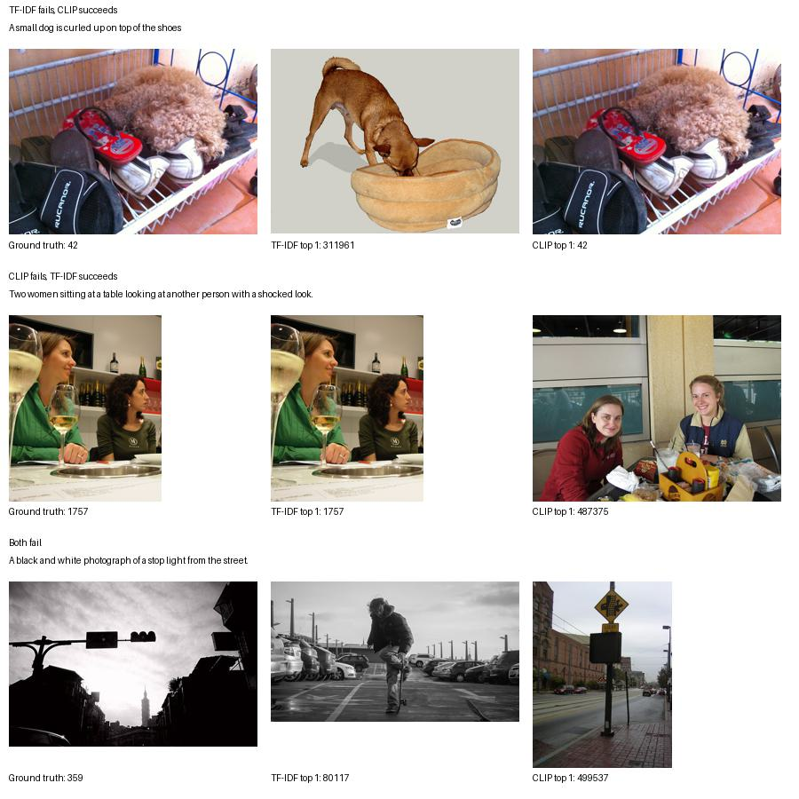
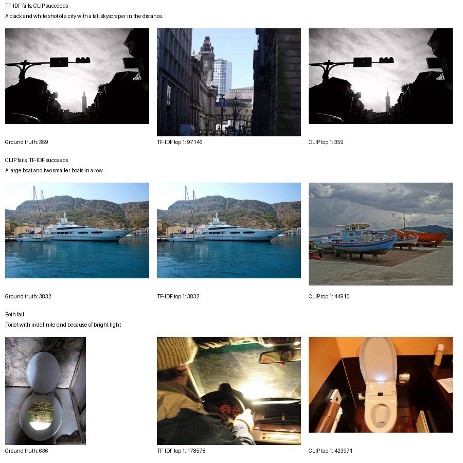
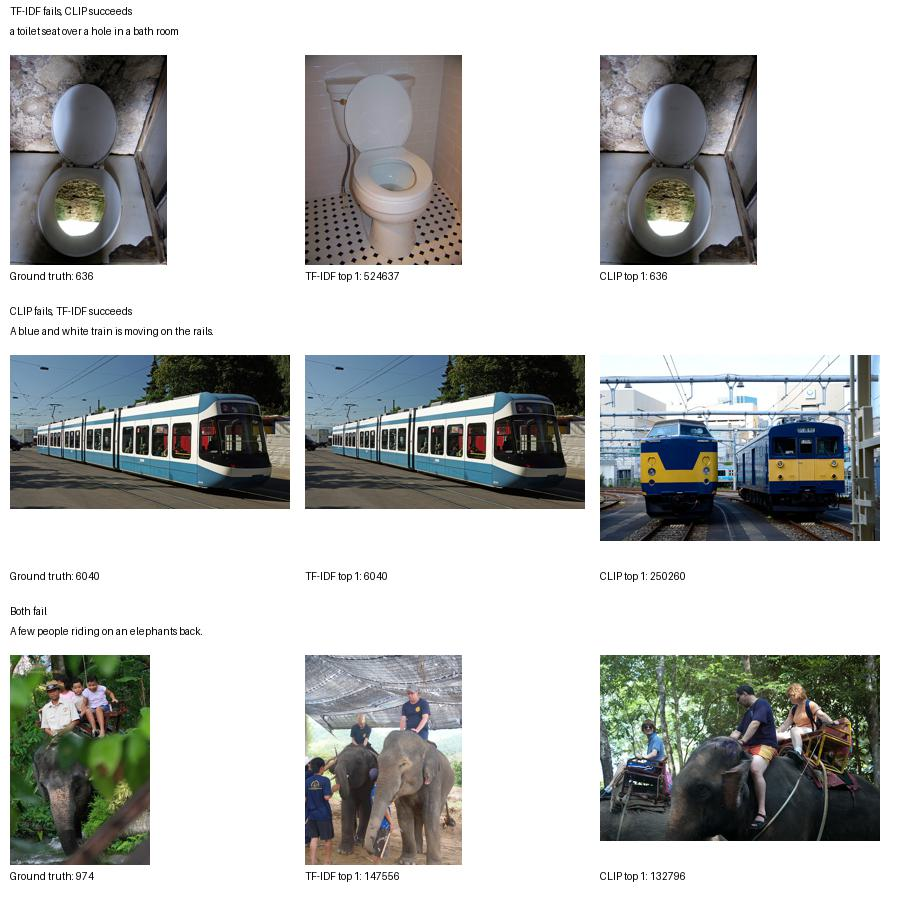

# Experimental Results

## Dataset and protocol

We use the COCO 2014 Karpathy split:

| Split | Images | Use |
|---|---:|---|
| Train | 113,287 | Not used for parameter updates in this zero-shot project |
| Validation | 5,000 | Backbone selection |
| Test | 5,000 | Final evaluation |

Each evaluation uses a 5,000-image gallery and 25,010 caption queries.
Metrics are Recall@1, Recall@5, and Recall@10.

## Validation results

We compared CLIP backbones on the validation split and selected the model using validation performance.

| Model | Recall@1 | Recall@5 | Recall@10 |
|---|---:|---:|---:|
| CLIP ViT-B/32 | 30.59% | 56.36% | 67.33% |
| CLIP ViT-B/16 | **32.91%** | **58.66%** | **69.61%** |

**Selection:** ViT-B/16 was selected because it performed best at all retrieval cutoffs.

## Final test results

| Method | Recall@1 | Recall@5 | Recall@10 |
|---|---:|---:|---:|
| TF-IDF caption baseline | 17.42% | 36.03% | 46.31% |
| CLIP ViT-B/32 | 30.45% | 55.97% | 66.86% |
| CLIP ViT-B/16 | **33.08%** | **58.36%** | **68.96%** |

CLIP ViT-B/16 substantially outperformed the caption-based TF-IDF baseline, particularly at Recall@1.

## Failure analysis

We categorized test-set errors using the TF-IDF baseline and CLIP ViT-B/16:

| Category | Queries | Percent of 25,010 queries |
|---|---:|---:|
| TF-IDF misses top 10; CLIP ranks correct image first | 3,092 | 12.36% |
| CLIP misses top 10; TF-IDF ranks correct image first | 543 | 2.17% |
| Both systems miss the correct image in the top 10 | 5,562 | 22.24% |

CLIP often succeeded on object relationships and unusual visual configurations, such as a dog curled on shoes or a toilet seat over a hole. TF-IDF sometimes succeeded when caption wording closely matched the correct image annotations. Both systems struggled with fine-grained differences, image style, uncommon viewpoints, and visually similar images where only one exact image is considered correct.

## Example retrieval errors

Each row compares the ground-truth image with the top-ranked TF-IDF and CLIP result.

